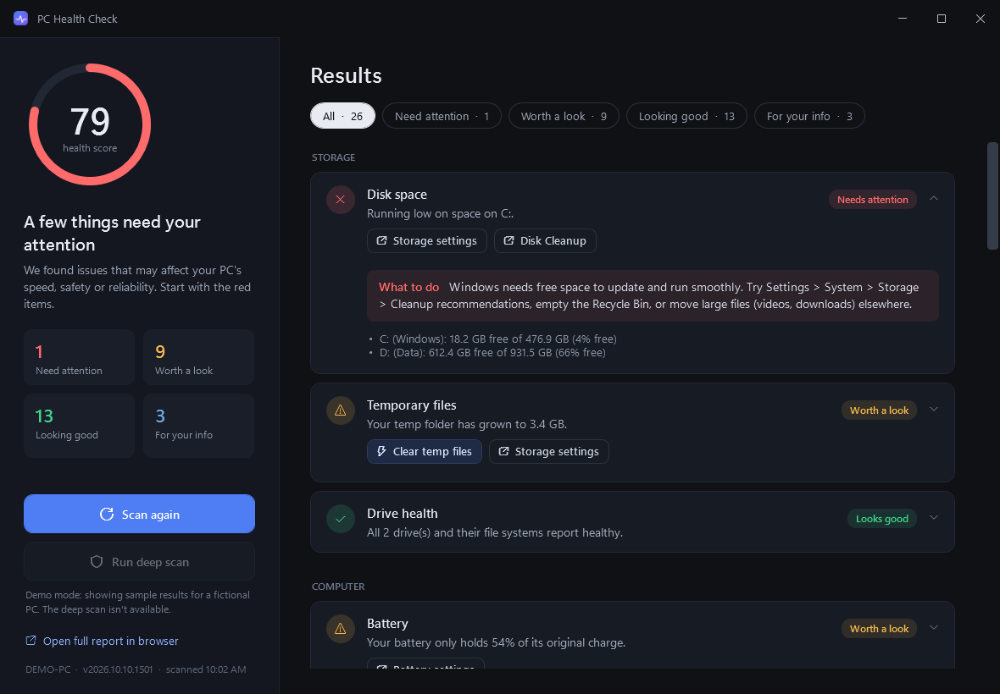
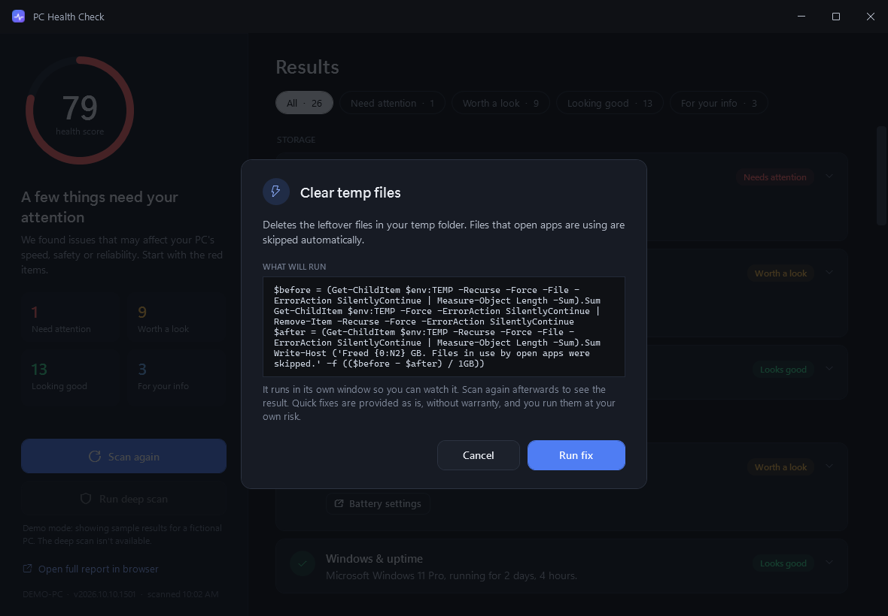
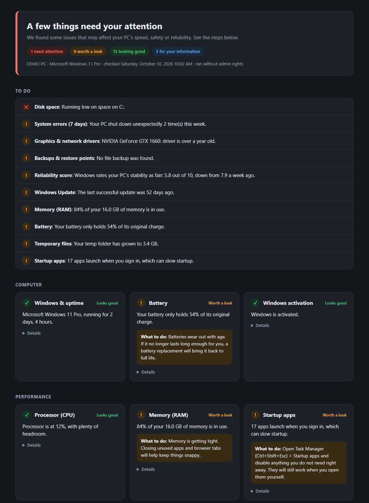

# PC Health Check

[](https://github.com/evansmith1377/pc-health-check/actions/workflows/ci.yml)
[](https://github.com/evansmith1377/pc-health-check/releases/latest)
[](LICENSE)

A friendly Windows diagnostics app. It runs the checks a technician would run (disk space, drive health, crashes, drivers, security, updates and more) and explains every result in plain English, with one-click quick fixes for the things it finds.



<sub>Screenshots are from demo mode (sample results for a fictional PC).</sub>

- **Native Windows app.** A single, small `.exe` with a dark, modern interface. Results stream in as each check finishes.
- **Plain-English results.** Every finding gets a status (needs attention, worth a look, looks good, FYI), a summary, what to do about it, and the technical details for anyone who wants them.
- **Quick fixes.** Buttons jump straight to the right Windows setting or tool, or run a fix (for example, clear temp files or create a restore point) after showing you exactly what will run.
- **Read-only scanning.** Scanning never changes anything on your PC. Only the quick fixes you choose to run make changes.
- **No install, no dependencies.** It uses only what ships with Windows 10 and 11: PowerShell 5.1 and .NET Framework 4.8.
- **Also works as a script.** `PCHealthCheck.ps1` runs on its own and writes a self-contained HTML report.

## Download

Get **`PCHealthCheck.exe`** from the [latest release](https://github.com/evansmith1377/pc-health-check/releases/latest) and double-click it. There's nothing to install.

> The exe isn't code-signed, so Windows SmartScreen may show "Windows protected your PC" the first time. Choose **More info -> Run anyway**. Each release lists SHA-256 hashes so you can verify the download.

## What it checks

26 checks in the standard scan (about 30 seconds, no admin rights needed), plus 4 more in the optional deep scan (15-30 minutes, needs admin):

| Area | Checks |
|---|---|
| Computer | Windows version & uptime, battery health, Windows activation |
| Performance | CPU load and busiest apps, memory use and biggest apps, startup apps |
| Storage | Free space per drive, drive & file system health, temp folder size, *drive wear (SMART)*\* |
| Network | Connection, latency, packet loss, DNS, Wi-Fi signal |
| Security & updates | Antivirus, firewall, Secure Boot / TPM / BitLocker, app updates (winget), Windows Update, pending restart |
| Stability | System errors, app crashes, device driver problems, core services, blue-screen crash history, recent driver installs, hardware error reports, graphics & network driver age, Windows reliability score |
| Backup & recovery | OneDrive folder backup, File History, restore points |
| System integrity\* | DISM image health, chkdsk online scan, SFC verify |

\* deep scan only

See [docs/checks.md](docs/checks.md) for exactly what each check looks at and when it flags something.

## Quick fixes

Findings that need attention come with buttons:

- **Open** buttons (outlined) jump to the relevant Windows Settings page, tool (Task Manager, Device Manager, Reliability Monitor...) or driver download site. They change nothing.
- **Run** buttons (blue) make a change. You'll see a confirmation dialog that explains the fix and shows the exact command first. The fix runs in its own PowerShell window so you can watch it. A shield icon means it needs administrator permission.



The full list is in [docs/quick-fixes.md](docs/quick-fixes.md).

## HTML report

Every scan also saves a self-contained HTML report (light and dark themes) to `Documents\PC Health Reports`. Open it from the app with **Open full report in browser**.

<details>
<summary>Report screenshot</summary>



</details>

## Using the script directly

```powershell
.\PCHealthCheck.ps1            # standard scan, opens the HTML report
.\PCHealthCheck.ps1 -Deep      # adds the deep-scan checks (asks for admin)
.\PCHealthCheck.ps1 -Demo      # sample results for a fictional PC
.\PCHealthCheck.ps1 -NoOpen -OutputFolder C:\Reports
```

If PowerShell blocks the script, run it with `powershell -ExecutionPolicy Bypass -File .\PCHealthCheck.ps1`.

## App command line

| Option | What it does |
|---|---|
| `--demo` | Show sample results for a fictional PC instead of scanning this one |
| `--deep` | Start with a deep scan (the app relaunches itself as administrator with this) |
| `--screenshot <file.png>` | Render the window to an image after the scan, then exit. The exit code is the number of results |
| `--expand-first`, `--show-fix-dialog` | With `--screenshot`: expand the first card, or open a quick-fix dialog |

## Building

No SDK or downloads needed. The build uses the C# compiler that ships with Windows:

```powershell
.\build.ps1                          # version = current UTC date/time, e.g. 2026.10.10.1423
.\build.ps1 -Version 2026.10.10.1423
```

This produces `dist\PCHealthCheck.exe` (about 150 KB), with the diagnostics script, window layout and icon embedded. Close the app before rebuilding, because a running exe can't be overwritten.

To regenerate the screenshots (demo mode only, so they never show your own PC), run `.\scripts\make-screenshots.ps1`.

## Tests

The [Pester](https://pester.dev) suite in `tests/` covers:

- **Script hygiene:** parses cleanly, ASCII-only for PowerShell 5.1, check counts match the app.
- **Helper functions:** byte and duration formatting, status ranking, result shape.
- **Quick fixes:** every fix is well formed, every command is valid PowerShell, URLs are safe, admin only where needed, fixes target the right drive or service.
- **End-to-end demo scan:** streaming protocol, statuses, report contents, and a check that no details of the host PC leak into demo output.
- **Real scan smoke test** (tagged `Slow`): every check runs and returns valid results.
- **The app:** builds, is version-stamped, and renders all demo results and the quick-fix dialog.

```powershell
Install-Module Pester -MinimumVersion 5.5.0 -Scope CurrentUser   # once
.\tests\run-tests.ps1
.\tests\run-tests.ps1 -ExcludeTag Slow
```

CI runs the full suite on every push and pull request.

## Releases

Releases are made by the **Release** workflow (Actions -> Release -> Run workflow, or `gh workflow run release.yml`). It versions the build from the current UTC date and time (`vYYYY.MM.DD.HHMM`), runs the tests, and publishes `PCHealthCheck.exe` and `PCHealthCheck.ps1` with SHA-256 hashes.

## Project layout

```
PCHealthCheck.ps1        All checks, demo data, quick-fix definitions and the HTML report
build.ps1                Compiles the app into dist\PCHealthCheck.exe
gui\App.cs               WPF app: runs the script, renders results, quick fixes
gui\MainWindow.xaml      Window layout and styles
gui\app.manifest         asInvoker + per-monitor DPI awareness
gui\make-icon.ps1        Generates gui\app.ico
scripts\                 Screenshot generator
tests\                   Pester tests and runner
docs\                    Check reference, quick-fix reference, architecture notes, screenshots
.github\workflows\       CI and Release workflows
```

How the app and script fit together is described in [docs/architecture.md](docs/architecture.md).

## Privacy

Everything runs locally. Nothing is uploaded anywhere. The only network activity is a few ping and DNS test packets for the connection check, `winget` checking for app updates, and Windows Update / Microsoft Defender if you run those fixes. Reports are written only to your own Documents folder.

## License and disclaimer

Released into the public domain under [The Unlicense](LICENSE). Use it for anything, no attribution required.

**This software is provided "as is", without warranty of any kind, and you use it, including any quick fixes, entirely at your own risk. The author accepts no liability for any damage, data loss or other harm arising from its use.** Read the full [DISCLAIMER.md](DISCLAIMER.md) before running quick fixes.
